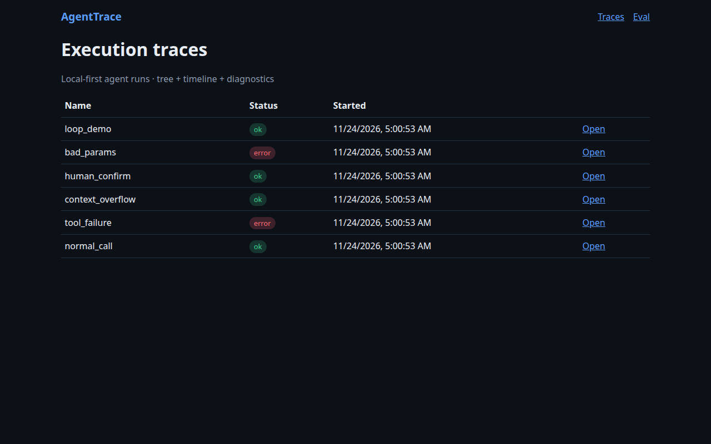
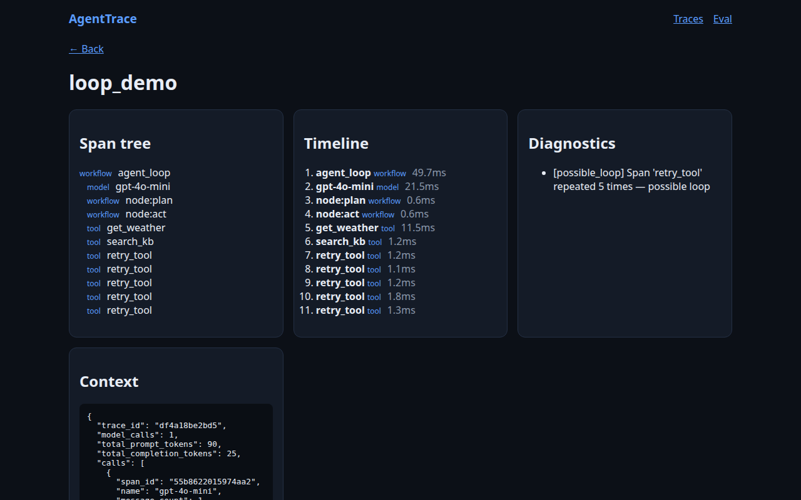
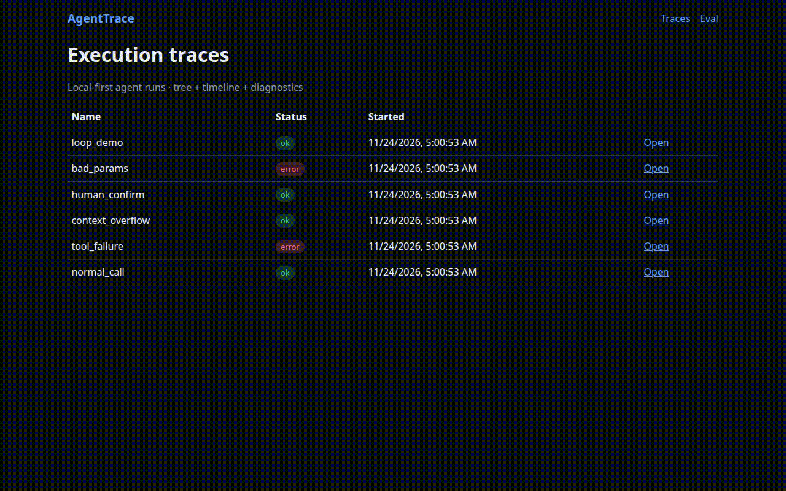

# AgentTrace

**Lightweight agent execution tracing, debugging, and eval** for LLM / Agent / Agent Skill developers.

AgentTrace is **local-first**, **independently installable**, and **not** a full agent platform. Plug the Python SDK into existing apps, inspect runs in a small React UI, and gate releases with golden evals.

[中文文档](README.zh-CN.md) · [Architecture](docs/architecture.md) · [Test report](tests/TEST_REPORT.md)







## Why AgentTrace?

| Problem | AgentTrace |
|---------|------------|
| Opaque agent execution | Tree + timeline spans (model / tool / workflow / human / MCP) |
| Hard-to-debug tool calls | Per-span I/O, diagnostics (failures, loops, bad params, context) |
| Hard-to-reproduce failures | SQLite history + node replay API |
| No regression evals | Golden datasets, assertions, run compare |

**Compared to Langfuse / Phoenix / LangSmith:** smaller deploy surface (SQLite default), explicit **skill I/O debug**, and **low integration cost** — decorators + optional adapters, not a hosted platform.

## Quick start

```bash
git clone https://github.com/czmir/AgentTrace.git
cd AgentTrace
./scripts/quickstart.sh
```

Or manually:

```bash
python -m venv .venv && source .venv/bin/activate
pip install -e ".[dev,server]"
export AGENTTRACE_DB=./data/traces.db
python examples/demo_agent.py
uvicorn backend.app.main:app --port 8765 &
cd frontend && npm install && npm run dev
```

Open the UI at `http://127.0.0.1:4321`.

## Python SDK

```python
from agenttrace import TraceSession, trace_span
from agenttrace.core import SpanKind
from agenttrace.recorder import TraceRecorder

rec = TraceRecorder("./data/traces.db")

with TraceSession("my-agent", recorder=rec) as session:
    with session.span("plan", SpanKind.WORKFLOW) as span:
        span.output = {"step": "search"}
```

- **Decorators:** `@trace_span("tool_name", kind=SpanKind.TOOL)`
- **Adapters:** `agenttrace.adapters` (LangGraph node wrapper, LangChain-style handler, OpenAI middleware, MCP wrapper)
- **CLI:** `agenttrace list`, `agenttrace diagnose <id>`, `agenttrace eval examples/eval/golden_v1.json --example`

## Features (v0.1)

1. SDK — sessions, spans, SQLite recorder, OTel mapping helper  
2. UI — trace list, tree, timeline, diagnostics, context panel, eval trigger  
3. Skill debug — load `SKILL.md`, JSON Schema validation, param checks  
4. Replay — re-run a span with stored input (`/api/traces/{id}/replay`)  
5. Eval — batch golden cases + `compare_eval_runs` for prompt/model drift  

## E2E demo scenarios

`examples/demo_agent.py` records:

- `normal_call` · `tool_failure` · `context_overflow` · `human_confirm` · `bad_params` · `loop_demo`

## License

MIT — see [LICENSE](LICENSE).