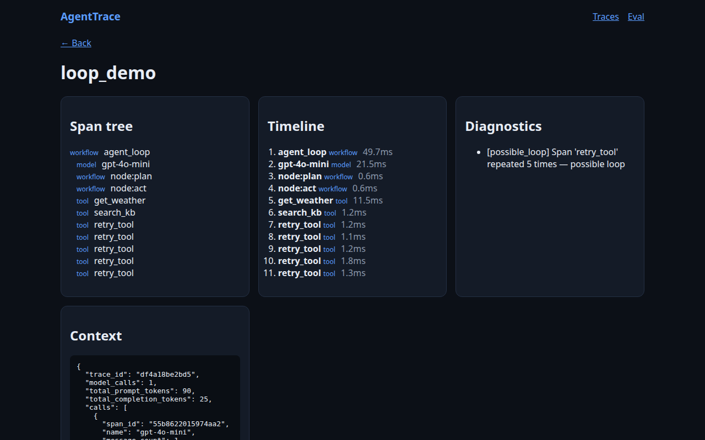
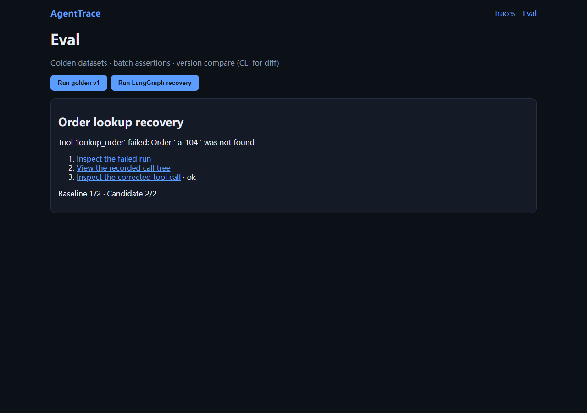

# AgentTrace

面向 **LLM / Agent / Agent Skill** 开发者的轻量 **执行追踪、调试、评测** 工具。

AgentTrace 坚持 **local-first**、**可独立安装的 Python SDK**，不做完整的 Agent 平台。用装饰器或 adapter 接入现有项目，在 React UI 里看 trace，用 golden eval 做回归。

[English](README.md) · [架构说明](docs/architecture.md) · [已知限制](docs/LIMITATIONS.md) · [Windows 启动](docs/windows.md) · [测试报告](tests/TEST_REPORT.md)





## 解决什么问题？

| 痛点 | AgentTrace |
|------|------------|
| 执行过程黑盒 | Span 树 + 时间线（model / tool / workflow / human / MCP） |
| Tool call 难调试 | 每步 I/O、自动 diagnostics（失败、循环、参数、上下文） |
| 问题难复现 | SQLite + **history replay**（拷贝 I/O）与 **re-execute**（handler registry） |
| 发版无回归 | JSON golden dataset；未知 assertion type **必须失败**，不会 silent pass |

**与 Langfuse / Phoenix / LangSmith 差异：** 默认 SQLite、部署面小；内置 **Skill I/O 调试**；集成成本低（`TraceSession` + adapter），而不是一体化观测平台。

## 快速开始

```bash
git clone https://github.com/czmir/AgentTrace.git
cd AgentTrace
./scripts/quickstart.sh
```

Windows 见 [`docs/windows.md`](docs/windows.md)。

```bash
pip install -e ".[dev,server,integrations]"
export AGENTTRACE_DB=./data/traces.db
python examples/demo_agent.py
uvicorn backend.app.main:app --port 8765 &
cd frontend && npm ci && npm run dev
```

浏览器打开 `http://127.0.0.1:4321`。Vite 把 `/api` **proxy 到真实 FastAPI**，不是 mock。

## SDK 示例

```python
from agenttrace import TraceSession
from agenttrace.core import SpanKind
from agenttrace.recorder import TraceRecorder

rec = TraceRecorder("./data/traces.db")
with TraceSession("我的 Agent", recorder=rec) as session:
    with session.span("推理", SpanKind.MODEL, input={"messages": []}) as s:
        s.output = {"content": "你好"}
```

Async：`async with TraceSession(...) as session:` + `session.aspan(...)`。

## 功能一览（v0.3.0）

- Python SDK：`pip install -e .`（asyncio parent/child 用 contextvars，避免 span 串台）
- FastAPI + SSE + React UI（UI 打真实 backend）
- Skill debug：加载 `examples/skills/*/SKILL.md`
- Replay：history vs re-execute；HTTP 只提供 history（避免 UI 触发 side effects）
- Eval：`examples/eval/golden_v1.json`；非法 config 明确 FAIL
- Redact：API key / Authorization / 敏感字段写入 SQLite 前脱敏

## Demo 场景

快速启动后打开 **Eval → Run LangGraph recovery**。案例用真实的异步 LangGraph 执行本地订单查询。带空格和小写字母的订单编号触发工具失败，修复后的处理器对原输入做归一化并重新执行。结果页可打开失败诊断、历史调用树和修复后的工具追踪，并对照原版与修复版的回归评测。



[复现命令和实现说明](docs/recovery.md)

`examples/demo_agent.py` 是 **mock 场景**（自动化测试用），不是 live LLM。真 LangGraph + LLM 见 `examples/integrations/langgraph_weather.py`：没有 `OPENAI_API_KEY` 会 **skip**，不会伪造 token。

## License

MIT
