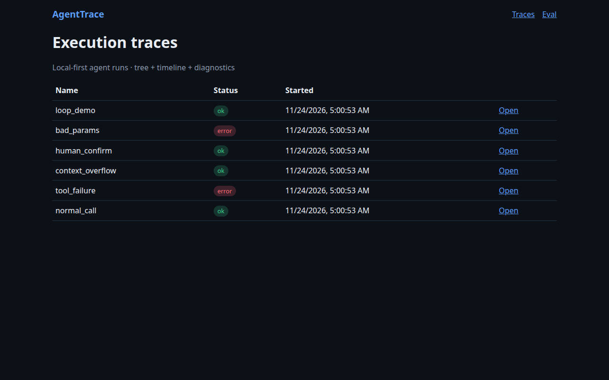
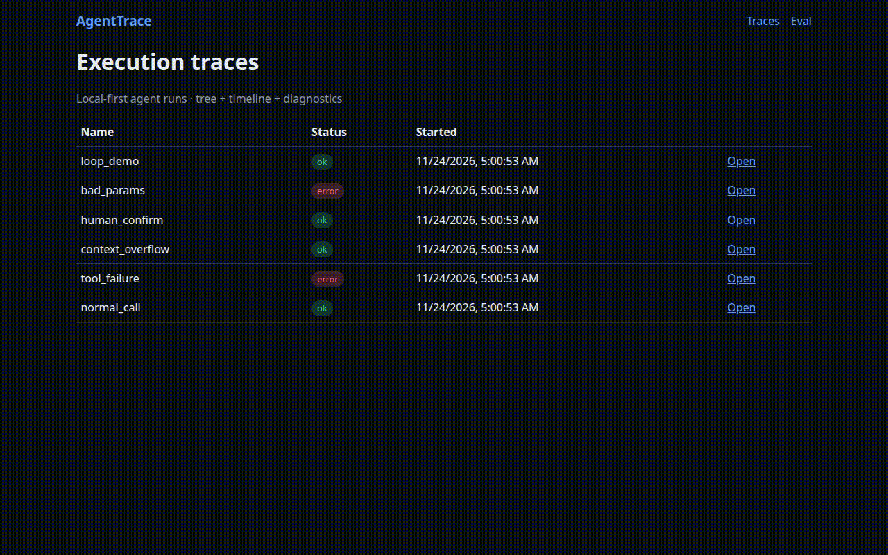

# AgentTrace

面向 **LLM / Agent / Agent Skill** 开发者的轻量 **执行追踪、调试、评测** 工具。

AgentTrace 坚持 **local-first**、**可独立安装的 Python SDK**，不做完整的 Agent 平台。用装饰器或 adapter 接入现有项目，在 React UI 里看 trace，用 golden eval 做回归。

[English](README.md) · [架构说明](docs/architecture.md) · [测试报告](tests/TEST_REPORT.md)






## 解决什么问题？

| 痛点 | AgentTrace |
|------|------------|
| 执行过程黑盒 | Span 树 + 时间线（model / tool / workflow / human / MCP） |
| Tool call 难调试 | 每步 I/O、自动 diagnostics（失败、循环、参数、上下文） |
| 问题难复现 | SQLite 持久化 + 节点 replay API |
| 发版无回归 | JSON golden dataset + 断言 + 版本对比 |

**与 Langfuse / Phoenix / LangSmith 差异：** 默认 SQLite、部署面小；内置 **Skill I/O 调试**；集成成本低（`TraceSession` + adapter），而不是一体化观测平台。

## 快速开始

```bash
git clone https://github.com/czmir/AgentTrace.git
cd AgentTrace
./scripts/quickstart.sh
```

```bash
pip install -e ".[dev,server]"
export AGENTTRACE_DB=./data/traces.db
python examples/demo_agent.py
uvicorn backend.app.main:app --port 8765 &
cd frontend && npm install && npm run dev
```

浏览器打开 `http://127.0.0.1:4321`。

## SDK 示例

```python
from agenttrace import TraceSession
from agenttrace.core import SpanKind
from agenttrace.recorder import TraceRecorder

rec = TraceRecorder("./data/traces.db")
with TraceSession("我的 Agent", recorder=rec) as session:
    with session.span("推理", SpanKind.MODEL, input={"messages": []}) as s:
        s.output = {"content": "你好"}
```

## 功能一览（v0.1）

- Python SDK：`pip install agenttrace`（本仓库 `pip install -e .`）
- FastAPI + SSE + React UI
- Skill debug：加载 `examples/skills/*/SKILL.md`，校验入参/出参
- Replay：按 span 重放
- Eval：`examples/eval/golden_v1.json`，CLI/UI 均可触发

## Demo 场景

`examples/demo_agent.py`：正常调用、工具失败、上下文溢出、人工确认、错误参数、循环检测。

## License

MIT