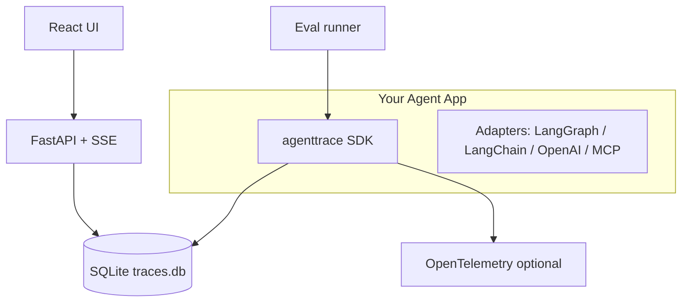

# AgentTrace architecture

## Design principles

- **Local-first** — single SQLite file, no mandatory cloud
- **Low integration cost** — `TraceSession` + `@trace_span` or adapter callbacks
- **Not a platform** — no hosting, orchestration, or prompt CMS
- **Debuggable** — tree, timeline, diagnostics, replay hooks, golden evals
- **Data safety** — redact secrets at persist time; HTTP replay is history-only

## Span parent/child (asyncio)

`TraceSession` stores the current span id in a `ContextVar`, not a shared list. Concurrent `asyncio` tasks keep their own parent. See `tests/test_session_asyncio.py`.

## Replay modes

| Mode | What it does | Side effects |
|------|----------------|--------------|
| `history` | Copy stored I/O into a new trace | None |
| `reexecute` | Call `HandlerRegistry` handlers | Gated by `allow_side_effects`, version bind, human confirm |

## vs Langfuse / Phoenix / LangSmith

| | AgentTrace | Langfuse | Phoenix | LangSmith |
|---|------------|----------|---------|-----------|
| Deploy footprint | SDK + optional UI | Web + Worker + PG + ClickHouse + Redis | 1 container | Managed |
| Agent skill debug | SKILL.md IO validation | Limited | Limited | Limited |
| Eval regression | JSON golden + compare | Yes (heavier) | Notebook evals | Datasets |
| MCP span kind | Yes | Via OTel | Via OTel | Limited |

AgentTrace targets **developers** who want traces **in-repo** next to their agent, not a full observability suite.

Honest gaps: [LIMITATIONS.md](LIMITATIONS.md).
