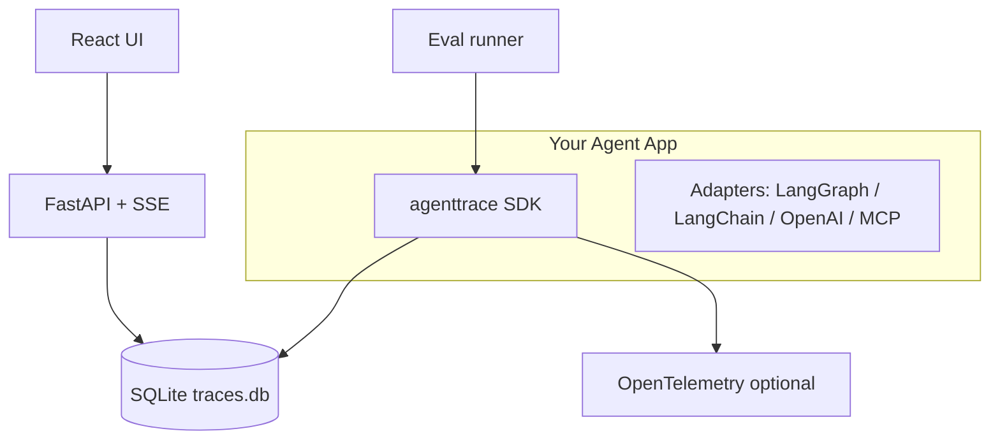

# AgentTrace architecture

## Design principles

- **Local-first** — single SQLite file, no mandatory cloud
- **Low integration cost** — `TraceSession` + `@trace_span` or adapter callbacks
- **Not a platform** — no hosting, orchestration, or prompt CMS
- **Debuggable** — tree, timeline, diagnostics, replay hooks, golden evals

## vs Langfuse / Phoenix / LangSmith

| | AgentTrace | Langfuse | Phoenix | LangSmith |
|---|------------|----------|---------|-----------|
| Deploy footprint | SDK + optional UI | Web + Worker + PG + ClickHouse + Redis | 1 container | Managed |
| Agent skill debug | SKILL.md IO validation | Limited | Limited | Limited |
| Eval regression | JSON golden + compare | Yes (heavier) | Notebook evals | Datasets |
| MCP span kind | Yes | Via OTel | Via OTel | Limited |

AgentTrace targets **developers** who want traces **in-repo** next to their agent, not a full observability suite.