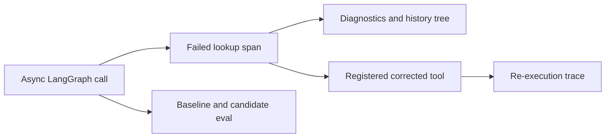

# Reproduce the order lookup incident

Start the app with the README quick start and open **Eval → Run LangGraph recovery**. The graph runs asynchronously with an in-memory order catalog. Its lookup tool initially treats whitespace and letter case as significant. The corrected handler normalizes the identifier before looking it up.



- A **span** records one operation inside a trace, with its parent ID, timing, input, output and error. A trace groups spans across the entire run. Task-local context variables carry parent IDs through asynchronous calls.
- **Incremental persistence** writes individual span changes to SQLite while the session runs. Readers combine the saved trace header with those rows. Session close writes a full snapshot and clears the incremental rows in one transaction. A process exit can leave a partially recorded trace marked running. The records still show which spans closed.
- **History replay** copies stored span data and remaps parent IDs to the replay tree. **Re-execution** invokes a registered handler on the recorded input and persists a new trace with a source span link. The generic HTTP replay endpoint supports history. The order demo can execute its fixed local tool.
- Known credential patterns and keys are redacted before trace data is persisted. This protects recognized fields and values. Custom identifiers and arbitrary sensitive text need application-specific filtering. A sanitized trace can omit credentials required by a real tool, so the application supplies any required credentials separately.

For a terminal run, install the integrations extra and run:

```sh
python -m examples.integrations.langgraph_recovery --db data/recovery.db
```

The JSON output contains linked trace IDs, the diagnostic, retry output and both eval runs. Keep this SQLite database separate from production traces. The demo workflow uses fixed test orders and needs no model key.

[Captured run JSON](recovery-run.json) · [Langfuse tracing reference](https://langfuse.com/docs/observability/overview)
